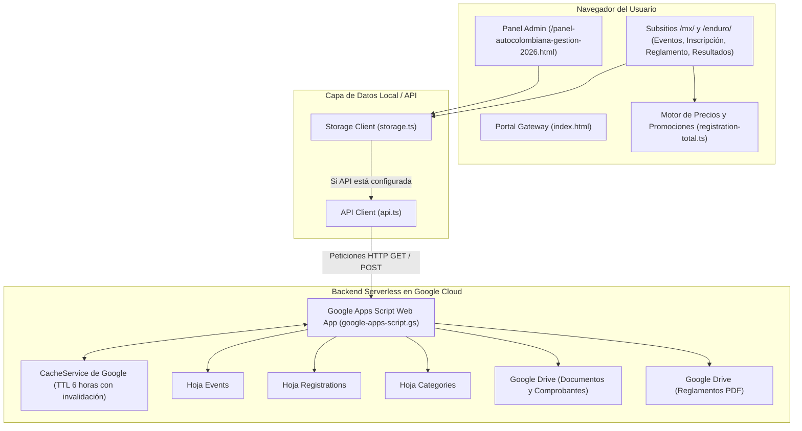

# Copa Autocolombiana 2026 — Plataforma Oficial

Plataforma web integral de la **Copa Autocolombiana** para sus dos campeonatos oficiales:
1. **Copa Autocolombiana de Clubes MX** (Motocross).
2. **Festival de Enduro Autocolombiana — 1.ª Edición** (Sprint Enduro y Hard Scramble).

Incluye portal público con arquitectura multi-campeonato, sistema de inscripción dinámico con cálculo de tarifas y promociones en vivo, reglamentos oficiales interactivos, visualización de resultados por mangas y un **panel de administración avanzado** respaldado por un backend **serverless** en Google Workspace (Google Sheets, Apps Script y Google Drive) desplegado en **GitHub Pages**.

---

## Tabla de contenidos

- [Visión general y campeonatos](#visión-general-y-campeonatos)
- [Funcionalidades del desarrollo](#funcionalidades-del-desarrollo)
  - [1. Portal público multi-campeonato](#1-portal-público-multi-campeonato)
  - [2. Sistema de inscripción inteligente](#2-sistema-de-inscripción-inteligente)
  - [3. Información bancaria editable por evento](#3-información-bancaria-editable-por-evento)
  - [4. Precios por categoría ("Precio distinto")](#4-precios-por-categoría-precio-distinto)
  - [5. Sistema de promociones por evento](#5-sistema-de-promociones-por-evento)
  - [6. Panel de administración de eventos e inscripciones](#6-panel-de-administración-de-eventos-e-inscripciones)
  - [7. Módulo de resultados de carrera](#7-módulo-de-resultados-de-carrera)
  - [8. Gestión dinámica de categorías](#8-gestión-dinámica-de-categorías)
- [Arquitectura del sistema](#arquitectura-del-sistema)
- [Tecnologías utilizadas](#tecnologías-utilizadas)
- [Estructura del proyecto](#estructura-del-proyecto)
- [Rutas y páginas](#rutas-y-páginas)
- [Backend Google Apps Script](#backend-google-apps-script)
- [Configuración del proyecto](#configuración-del-proyecto)
- [Instalación y comandos](#instalación-y-comandos)
- [Manual de marca](#manual-de-marca)

---

## Visión general y campeonatos

La plataforma opera como un portal unificado con selector de campeonato (gateway) y dos sub-sitios dedicados:

* **Clubes MX (`/mx/`)**:
  * Tres válidas oficiales puntuables con formato Triple Corona (mangas clasificatorias y finales).
  * Categorías oficiales infantiles (50cc, 65cc, 85cc) y adultos (125cc, MX Novatos, MX B, MX A, MX Master, Femenino, Enduro A, Enduro B).
* **Festival Enduro (`/enduro/`)**:
  * Competencia contra el cronómetro con 2 pruebas especiales en Sprint Enduro y un Hard Scramble.
  * Categorías propias: Enduro 1 (50cc 4T/2T), Enduro 2 (65cc/110cc/125cc), Enduro 3 (85cc/150cc), Juvenil, Bronce, Plata y Oro.

---

## Funcionalidades del desarrollo

### 1. Portal público multi-campeonato
- **Gateway de bienvenida (`/`)**: Selector interactivo entre Copa MX y Festival Enduro con estadísticas clave y logotipos oficiales.
- **Páginas de inicio dedicadas (`/mx/`, `/enduro/`)**: Hero banners de alto impacto, cronograma de válidas, categorías oficiales y accesos directos a inscripción.
- **Reglamentos oficiales (`/mx/reglamento.html`, `/enduro/reglamento.html`)**: Articulado navegable con índice interactivo y visualización/descarga de PDFs oficiales.
- **Calendario y eventos (`/mx/eventos.html`, `/enduro/eventos.html`)**: Estado de las válidas (abiertas, próximas, finalizadas) con enlaces directos a reglamentos específicos de cada evento y resultados.

---

### 2. Sistema de inscripción inteligente
- **Validación de edad en tiempo real**: Al ingresar la fecha de nacimiento, el sistema calcula la edad exacta y habilita únicamente las categorías permitidas por reglamento para el piloto.
- **Inscripción multi-categoría**: Un piloto puede seleccionar una o varias categorías permitidas para su edad.
- **Disponibilidad de número de piloto**: Comprueba contra Google Sheets en tiempo real que el número elegido (del 4 al 999) esté disponible en el evento.
- **Carga segura de archivos**: Soporte para subir documento de identidad y comprobante de consignación (imágenes o PDF con límite configurable) con almacenamiento automático en carpetas designadas de Google Drive.
- **Desglose de pago en vivo**: Subtotal, descuentos automáticos aplicados, promociones detectadas y total final calculado en tiempo real.

---

### 3. Información bancaria editable por evento
Cada evento puede tener su propia configuración de medios de pago, personalizable desde el panel administrativo mediante 3 checkboxes independientes:

1. **Cuenta Bancaria**:
   - Banco (ej: Bancolombia, Davivienda, etc.).
   - Tipo de cuenta (Ahorros / Corriente).
   - Número de cuenta.
   - Nombre del beneficiario o razón social.
   - Documento del beneficiario o NIT.
2. **Llave Bre-B**:
   - Nombre del beneficiario.
   - Llave Bre-B (número celular o llave alfanumérica).
3. **Cuenta Neobanco**:
   - Nombre del neobanco (Nu, Nequi, Daviplata, Lulo, etc.).
   - Nombre del beneficiario.
   - Número de cuenta o celular.

*En el formulario de inscripción:* Se generan tarjetas visuales estilizadas únicamente para los métodos de pago activados en el evento seleccionado, con botones de un solo clic para copiar los números al portapapeles.

---

### 4. Precios por categoría ("Precio distinto")
- Cada evento cuenta con un **precio de inscripción estándar** (ej: `$230.000 COP`).
- En el panel de administración, cada categoría cuenta con un checkbox de **"Precio distinto"**:
  - Al marcarlo, se le puede fijar una tarifa especial (ej: PW50 o Pitbike a `$170.000 COP`).
  - Al desmarcarlo, regresa a la tarifa estándar del evento.
- En la interfaz de inscripción, las categorías con precio especial muestran una insignia destacada con su valor específico.

---

### 5. Sistema de promociones por evento
Motor de promociones configurable de forma individual para cada evento con el botón **"+ Añadir promoción"**:

| Tipo de promoción | Comportamiento | Ejemplo |
|-------------------|----------------|---------|
| **Combo / Precio fijo total** | Paquete cerrado de $N$ categorías por un valor fijo total. Las categorías excedentes pagan tarifa normal. | 2 categorías por `$400.000` o 3 por `$600.000`. |
| **2x1** | Por cada 2 categorías elegibles, la de menor valor es 100% gratuita. | Inscribe 2 categorías y paga 1. |
| **Precio unitario por volumen** | A partir de $X$ categorías, cada una pasa a costar un valor unitario reducido. | Desde 2 categorías, cada una cuesta `$200.000`. |
| **Descuento fijo en el total** | Monto directo en COP a descontar del subtotal. | Descuento de `-$60.000 COP`. |
| **Descuento porcentual** | Porcentaje de descuento sobre las categorías elegibles. | `15%` de descuento. |

* **Segmentación por categorías específicas**: Las promociones pueden aplicar a todas las categorías del evento o limitarse exclusivamente a categorías seleccionadas mediante checkboxes (ej: solo categorías infantiles).
* **Selección automática del mayor beneficio**: Si aplican varias promociones al mismo tiempo, el motor calcula todas las opciones y aplica automáticamente la que represente el **mayor ahorro** para el usuario.

---

### 6. Panel de administración de eventos e inscripciones
Ruta de acceso: **`/panel-autocolombiana-gestion-2026.html`** (protegida con clave de sesión).

- **Gestión integral de eventos**:
  - Crear, editar, activar/desactivar inscripciones públicas y marcar eventos como finalizados.
  - Subida directa del PDF del reglamento oficial particular del evento a Google Drive.
  - Configuración completa de medios de pago, precios por categoría y promociones.
- **Gestión de inscripciones**:
  - Listado organizado por campeonato y por evento con contador de inscritos.
  - Visualización y edición en línea de datos del piloto (categorías, moto, número, datos personales).
  - Enlaces directos para visualizar el documento de identidad y el comprobante de pago guardados en Drive.
  - Eliminación segura con confirmación SweetAlert2.
- **Exportación de datos**:
  - Descarga inmediata de las planillas de inscritos en formato **Excel (.xlsx)** o **CSV (.csv)**.

---

### 7. Módulo de resultados de carrera
- Modal administrativo para cargar y gestionar resultados por evento y categoría.
- Gestión de mangas puntuables: **Manga 1**, **Manga 2**, **Manga 3** y **Final**.
- Carga masiva mediante importación de planillas **CSV** o entrada manual de posiciones, número, nombre, vueltas y tiempos.
- Los resultados se publican instantáneamente en las páginas públicas de resultados (`/mx/resultados.html` y `/enduro/resultados.html`).

---

### 8. Gestión dinámica de categorías
- Módulo dentro del panel administrativo para habilitar o inhabilitar categorías en cada campeonato.
- Las categorías inhabilitadas no se ofrecen a nuevos inscritos, pero se preservan para registros históricos y resultados.
- Sincronización bidireccional con la hoja `Categories` de Google Sheets.

---

## Arquitectura del sistema



---

## Tecnologías utilizadas

| Área | Herramientas / Librerías |
|------|--------------------------|
| **Lenguaje y Core** | TypeScript 5.8, HTML5 Semántico, JavaScript ES2022 |
| **Empaquetador y Build** | Vite 6 |
| **Estilos y Diseño** | Tailwind CSS 3, Vanilla CSS adaptado al manual de marca |
| **Componentes de UI** | SweetAlert2 (modales, confirmaciones, alertas de carga) |
| **Manejo de Hojas de Cálculo** | SheetJS (`xlsx`) para exportación en Excel y CSV |
| **Backend Serverless** | Google Apps Script (JavaScript V8) |
| **Base de Datos** | Google Sheets (`Events`, `Registrations`, `Categories`) |
| **Almacenamiento de Archivos** | Google Drive API (DriveApp) |
| **Hosting y Despliegue** | GitHub Pages con despliegue automatizado vía GitHub Actions |

---

## Estructura del proyecto

```
Copa Autocolombiana/
├── dist/                                  # Compilación estática optimizada para producción
├── docs/
│   ├── google-apps-script.gs              # Código fuente completo del backend en Apps Script
│   ├── SETUP-GOOGLE-SHEETS.md             # Guía paso a paso para configurar Google Sheets y Drive
│   └── ENCODING.md                        # Políticas de codificación UTF-8
├── enduro/                                # Vistas públicas del Festival de Enduro
│   ├── index.html, eventos.html, inscripcion.html, reglamento.html, resultados.html
├── mx/                                    # Vistas públicas de la Copa Clubes MX
│   ├── index.html, eventos.html, inscripcion.html, reglamento.html, resultados.html
├── public/                                # Recursos estáticos, imágenes, logos y datos mock
│   └── data/events.json                   # Eventos iniciales con tarifas y bancos por defecto
├── scripts/
│   ├── ensure-utf8.mjs                    # Validador de codificación UTF-8 previa al build
│   └── test-pricing.mjs                   # Suite de pruebas unitarias del motor de tarifas y promos
├── src/
│   ├── championships.ts                   # Configuración y metadatos de MX y Enduro
│   ├── config.ts                          # Variables de entorno y credenciales del panel
│   ├── main.ts                            # Entrada del portal gateway
│   ├── admin-main.ts                      # Entrada del panel de administración
│   ├── champ-*-main.ts                    # Entradas Vite para cada sub-sitio
│   ├── components/                        # Barra de navegación, footer, selector de campeonatos
│   ├── content/                           # Textos completos de los reglamentos oficiales
│   ├── pages/
│   │   ├── admin.ts                       # Lógica y vistas del panel administrativo
│   │   ├── admin-results-modal.ts         # Modal de gestión de mangas y resultados
│   │   ├── registration.ts                # Lógica del formulario de inscripción y bancos
│   │   ├── results.ts                     # Visualizador de resultados de carrera
│   │   └── ...
│   ├── types/
│   │   └── index.ts                       # Tipos TypeScript (Event, Promotion, BankingInfo, etc.)
│   └── utils/
│       ├── registration-total.ts          # Motor de cálculo de precios y mejores promociones
│       ├── storage.ts                     # Capa unificada de almacenamiento (Local / Google Sheets)
│       └── api.ts                         # Cliente HTTP para la Web App de Apps Script
├── package.json
├── tailwind.config.js
├── tsconfig.json
└── vite.config.ts
```

---

## Rutas y páginas

| URL / Archivo | Propósito |
|---|---|
| `/index.html` | Portal gateway para seleccionar entre Copa MX y Festival Enduro |
| `/mx/index.html` | Inicio de la Copa Autocolombiana de Clubes MX |
| `/mx/eventos.html` | Calendario, sedes y reglamentos de MX |
| `/mx/inscripcion.html` | Formulario de inscripción oficial con tarifas de MX |
| `/mx/reglamento.html` | Reglamento deportivo oficial de MX |
| `/mx/resultados.html` | Clasificaciones oficiales por manga y categoría de MX |
| `/enduro/index.html` | Inicio del Festival de Enduro Autocolombiana |
| `/enduro/eventos.html` | Calendario de ediciones y pruebas especiales de Enduro |
| `/enduro/inscripcion.html` | Formulario de inscripción oficial con tarifas de Enduro |
| `/enduro/reglamento.html` | Reglamento oficial de Enduro |
| `/enduro/resultados.html` | Tiempos y clasificaciones de Enduro |
| `/panel-autocolombiana-gestion-2026.html` | Panel de administración central protegido por contraseña |

---

## Backend Google Apps Script

El archivo [`docs/google-apps-script.gs`](docs/google-apps-script.gs) contiene toda la lógica de negocio ejecutada en la nube de Google:

- **Estructura de la hoja `Events`**:
  `['id', 'name', 'date', 'location', 'city', 'description', 'active', 'reglamentoUrl', 'finished', 'valorInscripcion', 'championshipId', 'resultadosUrl', 'bankingInfo', 'categoryPrices', 'promotions']`
- **Estructura de la hoja `Registrations`**:
  `['id', 'eventId', 'eventName', 'nombre', 'apellido', 'identificacion', 'identificacionArchivo', 'identificacionFileName', 'identificacionFileType', 'comprobantePagoUrl', 'comprobantePagoFileName', 'comprobantePagoFileType', 'fechaNacimiento', 'edad', 'email', 'celular', 'ciudad', 'marcaMoto', 'numeroPiloto', 'categoriaId', 'categoriaLabel', 'valorTotalInscripcion', 'createdAt', 'updatedAt']`
- **Estructura de la hoja `Categories`**:
  `['id', 'championshipId', 'label', 'minAge', 'maxAge', 'active']`

*Características técnicas del script:*
- Detección automática y agregado de nuevas columnas sin pérdida de datos (`ensureSheetHeaders_`).
- Subida automática de adjuntos en Base64 convertidos a archivos nativos en carpetas específicas de Google Drive con permisos públicos de visualización.
- Caché de alto rendimiento en Google Cloud (`CacheService`) con expiración de 6 horas e invalidación automática al guardar cambios en eventos o categorías.

---

## Configuración del proyecto

El archivo de configuración principal se encuentra en [`src/config.ts`](src/config.ts):

```typescript
export const CONFIG = {
  // Clave de acceso al panel de administración (/panel-autocolombiana-gestion-2026.html)
  adminPassword: 'tu-contraseña-admin',

  // URL del despliegue de Apps Script como Web App (dejar vacío para usar localStorage)
  apiUrl: 'https://script.google.com/macros/s/AKfycb.../exec',

  // Enlace directo opcional para abrir la Google Sheet desde el panel
  spreadsheetUrl: 'https://docs.google.com/spreadsheets/d/.../edit',

  // Tamaño máximo de comprobantes y documentos (en MB)
  maxFileSizeMB: 5,
};
```

---

## Instalación y comandos

### Requisitos previos
- Node.js 20 o superior.
- Gestor de paquetes `npm`.

### Comandos de ejecución

```bash
# Instalar dependencias
npm install

# Servidor de desarrollo local (http://localhost:5173)
npm run dev

# Ejecutar pruebas del motor de precios y promociones
node scripts/test-pricing.mjs

# Compilar proyecto para producción (genera carpeta dist/)
npm run build

# Previsualizar la versión compilada de producción
npm run preview

# Verificar y corregir codificación UTF-8 en archivos de texto
npm run check:encoding
npm run fix:encoding
```

---

## Manual de marca

| Color / Token | Valor HEX | Uso principal |
|---|---|---|
| **Fondo Base** | `#0a0a0a` / `#000000` | Fondos de página y superficies oscuras |
| **Superficie Elevada** | `#141414` / `#1a1a1a` | Tarjetas, contenedores y modales |
| **Acento Primario** | `#ffffff` | Títulos principales, botones primarios y contrastes |
| **Acento Secundario** | `#e5e5e5` / `#a3a3a3` | Textos secundarios, bordes y badges sutiles |
| **Acento Promoción / Éxito** | `#f59e0b` / `#10b981` | Insignias de tarifas especiales y ahorros |
| **Tipografía de Títulos** | `Bebas Neue` (Google Fonts) | Encabezados, títulos de sección y números de válidas |
| **Tipografía de Contenido** | `Montserrat` (Google Fonts) | Textos de párrafo, formularios y tablas |
